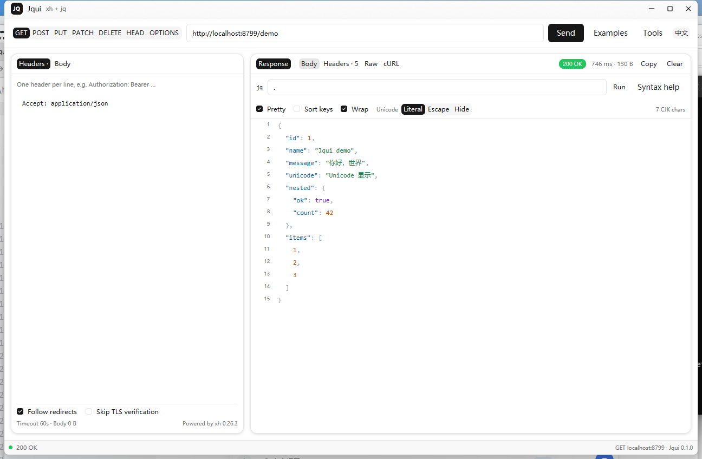

# Jqui

[](https://github.com/yorelog/jqui/actions/workflows/release.yml)
[](LICENSE)

**English** | [中文](README.zh-CN.md)

Jqui is a desktop HTTP / JSON client built on [gpui-shell](https://gpui-kit.com/). It combines **xh**'s request engine with **jq**'s query language in one window, and adds a display switch for Chinese and other non-ASCII text.



## Features

- **Any HTTP request**: GET / POST / PUT / PATCH / DELETE / HEAD / OPTIONS, with a custom URL, headers and body.
- **Real jq**: full jq syntax through the bundled native `jq` binary — variables, `reduce`/`foreach`, user functions, regex, and all builtins.
- **Request editor**: one header per line, JSON body formatting, automatic `Content-Type: application/json`, redirect and TLS controls.
- **Response views**: top-level **Response**, **Raw** and **cURL**; Response nests **Body / Headers**, and the jq toolbar belongs to Body only. Pretty or compact JSON, sorted keys, automatic line wrapping, line-by-line copy. Raw can also beautify the full response as JSON.
- **Unicode display modes**: literal / `\uXXXX` escapes / hidden (`·`) for Chinese and other non-ASCII text, with a CJK character count and hover help on the Unicode switch.
- **Bilingual UI**: switch between Chinese and English from the top-right button; the choice is remembered.
- **Tool updates**: check GitHub Releases for `xh` / `jq`, download the asset for the current platform, install it under the app data directory, and roll back on failure.

## Install

### Prebuilt packages

Download the latest package from [Releases](https://github.com/yorelog/jqui/releases/latest):

| Platform | Package | Start |
| --- | --- | --- |
| Windows x64 | `jqui-0.1.0-windows-x86_64.zip` | Unzip anywhere and open `Jqui.exe`. It is portable and carries gpui-shell 0.8.0. |
| macOS universal | `Jqui-0.1.0-macos-universal.zip` | Unzip and move `Jqui.app` to Applications. The package is unsigned. |
| Linux x64 | `jqui-0.1.0-linux.tar.gz` + `install.sh` | Run `sh install.sh`, or extract and start the launcher. |

macOS packages are unsigned and not notarized. On first launch, right-click the app and choose **Open**, or clear the quarantine flag:

```bash
xattr -dr com.apple.quarantine /Applications/Jqui.app
```

Linux needs a working Vulkan driver, `libxkbcommon`, the WebKitGTK 4.1 runtime (`libwebkit2gtk-4.1-0`), and a Wayland or X11 session, as required by gpui-shell.

The Windows package includes the gpui-shell runtime current at build time. macOS and Linux packages use an installed gpui-shell, or download the pinned 0.8.0 release once on first launch.

### From source

Requirements:

- [gpui-shell 0.8.0](https://gpui-kit.com/) on `PATH`
- Node.js 18 or newer (only for the tool download script)
- `tar` (built into Windows 10+, macOS and most Linux distributions)
- Linux builds: `libwebkit2gtk-4.1-dev`, `libwayland-dev`, `libxkbcommon-x11-dev`, `libx11-xcb-dev`, `libssl-dev`, `libzstd-dev`, `libasound2-dev`, `libfontconfig-dev`, `libvulkan1` (the release workflow installs these)

```bash
git clone https://github.com/yorelog/jqui.git
cd jqui
node scripts/fetch-tools.mjs        # downloads xh and jq for this platform
gpui-shell check -d .
gpui-shell run -d .
```

Use `gpui-shell dev -d .` to reload on save. The binaries are pinned to xh 0.26.3 and jq 1.8.2 and verified with SHA-256. They are ignored by Git; a release bundle includes the correct native binaries for each platform.

### Build a package

`gpui-shell bundle` packages the app, but the native tools must already be in the app directory. Stage a clean app directory per platform:

```bash
mkdir -p staging
cp -R main.js gpui-shell.json lib icons staging/
node scripts/fetch-tools.mjs --platform linux --arch x64 --out staging
gpui-shell check -d staging
gpui-shell bundle -d staging --platform linux --out dist \
  --icon icons/app-icon.png \
  --download-url "https://github.com/yorelog/jqui/releases/latest/download"
```

Use `--platform windows`, `--platform macos` or `--platform linux`. On macOS, use `--arch universal` (requires `lipo`) to produce one set of xh/jq binaries for both Apple silicon and Intel.

## Release

Releases are built by [`.github/workflows/release.yml`](.github/workflows/release.yml).

```bash
git tag v0.1.0
git push origin v0.1.0
```

The workflow validates that the tag matches `version` in `gpui-shell.json`, then builds:

- Windows x64 portable zip
- macOS universal `.app` zip (Apple silicon + Intel xh/jq)
- Linux x64 tarball and `install.sh`
- `SHA256SUMS.txt`

All artifacts are attached to the GitHub Release. You can also run the workflow manually with a tag name in **Actions → Release → Run workflow**.

By default the workflow installs the **latest** gpui-shell through gpui-kit's `install.sh` (macOS/Linux) or the latest Windows release asset, and verifies its SHA-256. Set the `gpui_shell_version` input to a tag such as `v0.8.0` when you need a reproducible build. The Windows zip bundles the runtime installed at build time; macOS/Linux packages do not embed a runtime.

The release is unsigned and not notarized: macOS users need the right-click/Open step above, and Windows may show a SmartScreen warning.

## Usage

### Requests

1. Pick a method and enter the URL. A missing scheme is treated as `https://`.
2. Put one header per line in **Headers**, for example `Authorization: Bearer …`.
3. Put the body in **Body**. JSON-looking bodies get `Content-Type: application/json` unless you set it yourself.
4. Click **Send**. Toggle **Follow redirects** or **Skip TLS verification** as needed.

### jq

The query runs against the parsed JSON response and may produce zero, one or many results:

```jq
.                                  # whole document
.user.name                         # field
.items[]                           # expand array / object
.items[0].id                       # index
.a, .b                             # multiple outputs
.a | .b                            # pipe
.a // "default"                    # fallback when missing
map(.id)                           # map
map(select(.ok))                   # filter
sort_by(.id)                       # sort
group_by(.type)                    # group
{name, stars: .stargazers_count}   # build an object
[.items[].id]                      # build an array
reduce .[] as $x (0; . + $x)       # aggregate
.headers | to_entries[]            # multiple outputs
```

Multiple outputs are shown as an array with a result count. If `jq` is missing, Jqui falls back to a built-in subset and says so in the syntax help.

The response panel is grouped as **Response (Body / Headers)**, **Raw**, and **cURL**. Body owns the jq toolbar, pretty/compact, key sorting and line wrapping; Headers shows the response headers without the jq controls; Raw and cURL are separate top-level views.

The **Wrap** switch in the response toolbar is on by default. It wraps long JSON lines to the window width (including long strings and titles); turn it off to return to the fixed one-line-per-row list. The choice is remembered.

The **Raw** view has its own **Beautify JSON** toggle and the Unicode display switch. Beautifying formats the *full* response and is independent of the jq filter; Copy copies whatever the current view shows.

### Unicode display

The **Unicode** switch in the response toolbar has three modes:

- **Literal**: literal characters, for example `"你好，世界"`.
- **Escape**: every non-ASCII character becomes a JSON `\uXXXX` escape, including surrogate pairs.
- **Hide**: every non-ASCII character becomes `·`, keeping the JSON structure readable.

Hover the **Unicode** label or any mode to see the conversion it performs, for example Chinese `中文` to `\u4e2d\u6587`. The setting applies to the Response view, Raw text and copied content, and the toolbar shows the CJK character count of the displayed result.


### UI language

Use the **EN / 中文** button at the top right. The interface language is saved with the application and restored on the next launch. Both the interface and this repository are bilingual.

### Tool updates

Open **Tools**:

- **Check for updates** reads the latest stable GitHub Releases for xh and jq and picks the asset for the current platform/architecture.
- **Update** downloads the asset with xh, extracts it with `tar`, installs it under the app data directory's `tools/` folder, keeps the previous version as `.bak`, and rolls back if the new binary cannot run.
- Updated tools are used immediately by later requests and jq queries. No restart is needed.
- The application directory is never modified. Delete `tools/` to return to the bundled versions.
- Unauthenticated GitHub API checks are limited to 60 per hour; the panel shows the rate-limit error when it is reached.

## Platform support

The updater selects assets from the running platform and CPU architecture:

| Platform | xh asset | jq asset |
| --- | --- | --- |
| Windows x64 | `xh-…-x86_64-pc-windows-msvc.zip` | `jq-windows-amd64.exe` |
| Windows arm64 | x64 build (emulation; xh has no native Windows arm64) | `jq-windows-arm64.exe` |
| macOS arm64 | `xh-…-aarch64-apple-darwin.tar.gz` | `jq-macos-arm64` |
| macOS x64 | `xh-…-x86_64-apple-darwin.tar.gz` | `jq-macos-amd64` |
| Linux arm64 | `xh-…-aarch64-unknown-linux-musl.tar.gz` | `jq-linux-arm64` |
| Linux x64 | `xh-…-x86_64-unknown-linux-musl.tar.gz` | `jq-linux-amd64` |

Other platforms or 32-bit architectures show “no asset for this platform” instead of downloading the wrong binary. Windows uses a small `cmd.exe` wrapper to restore `SystemRoot` and proxy variables for the child process; macOS/Linux use `chmod +x`; archives are extracted with the system `tar`.

## How requests are sent

gpui-shell's native `fetch` is capability-gated per exact host, method and path, which cannot support an API client with an arbitrary URL. Jqui uses xh instead:

1. Headers and the body are written to temporary files in the application data directory.
2. xh prints the response as headers, a blank line, then the body.
3. Jqui parses the status line and headers, then hands the body to jq.
4. Temporary files are removed after the request.

On Windows the child process starts with an empty environment, and Winsock fails without `SystemRoot`; Jqui generates a small `.cmd` wrapper that restores the needed variables. Header values are also passed through files, so quotes, `%`, `&` and `@` are not interpreted by `cmd.exe`.

## Capabilities

`gpui-shell.json` requests:

```json
"fs": {
  "read": ["${pluginDir}", "${dataDir}"],
  "write": ["${dataDir}"],
  "execute": "*"
},
"network": {
  "http": [
    {
      "scheme": "https",
      "host": "api.github.com",
      "methods": ["GET"],
      "path_prefixes": [
        "/repos/ducaale/xh/releases/latest",
        "/repos/jqlang/jq/releases/latest"
      ]
    }
  ]
},
"storage": true,
"clipboard": { "write": true }
```

- `execute: "*"` is unrestricted execution. It is required because the bundled or updated xh/jq binaries are invoked by absolute path, and gpui-shell's allowlist only matches exact command names. To narrow it, install xh/jq on `PATH` and replace this with `["xh", "xh.exe", "jq", "jq.exe"]`; Windows still needs `cmd.exe` for the environment wrapper.
- The only native `network.http` grant is for the two GitHub release endpoints used by the update check. Actual API requests go through xh, outside that grant.
- Read roots are the application directory and its data directory; writes stay in the data directory.

## Limitations

- A response is effectively capped by gpui-shell's ~8 MiB `process.run` output limit. Use jq to narrow very large responses.
- Only the last request is remembered (URL, headers, body, jq expression); there is no saved-request collection yet.
- HEAD responses have no body by definition.
- On Windows a URL cannot contain a literal double quote; encode it as `%22`.
- The built-in jq subset is only a fallback. Release packages include the real jq binary.
- Packages are unsigned; macOS and Windows will show their usual first-run warnings.

## Security and privacy

- The last request, including any token in its headers, is stored in the gpui-shell application data directory:
  `%APPDATA%\gpui-shell\apps\local.jqui\store.json` on Windows. Use **Clear** or remove that file on a shared machine.
- Header/body/JSON temporary files live in the same data directory and are removed after each request.
- The application sends no telemetry and does not copy request content anywhere else.
- Tool updates are downloaded over HTTPS from GitHub Releases and checked against the pinned SHA-256 values in `scripts/fetch-tools.mjs` during packaging; runtime updates verify the download size.

## Project layout

```text
main.js                 # UI, state and events
lib/i18n.js             # Chinese/English interface strings
lib/http.js             # xh invocation, Windows cmd wrapper, response parsing
lib/jq-runner.js        # jq binary invocation and result handling
lib/jq.js               # built-in jq subset (fallback only)
lib/tools.js            # xh/jq release checks, platform assets, install/rollback
lib/json-view.js        # JSON lines, colouring, Unicode escape/hide
lib/runtime.js          # platform, architecture, bundled/managed tool paths
lib/store.js            # remember the last request
scripts/fetch-tools.mjs # download pinned native xh/jq for a target platform
icons/                  # window controls, checkbox, spinner, app icon
.github/workflows/      # multi-platform release workflow
docs/                   # screenshots
gpui-shell.json         # manifest
gpui-kit.d.ts           # generated gpui-shell declarations (do not edit)
```

## Third-party

- [xh](https://github.com/ducaale/xh) — MIT License
- [jq](https://github.com/jqlang/jq) — MIT License
- [gpui-kit](https://github.com/longbridge/gpui-kit) — Apache-2.0 / MIT

`xh` and `jq` are independent executables; Jqui only invokes them through the command line.

## License

[MIT](LICENSE)
