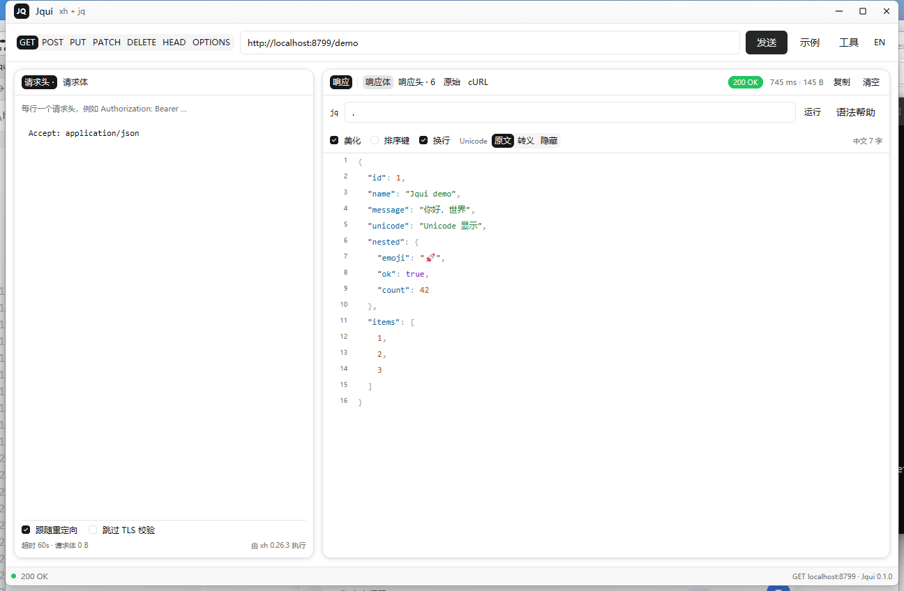
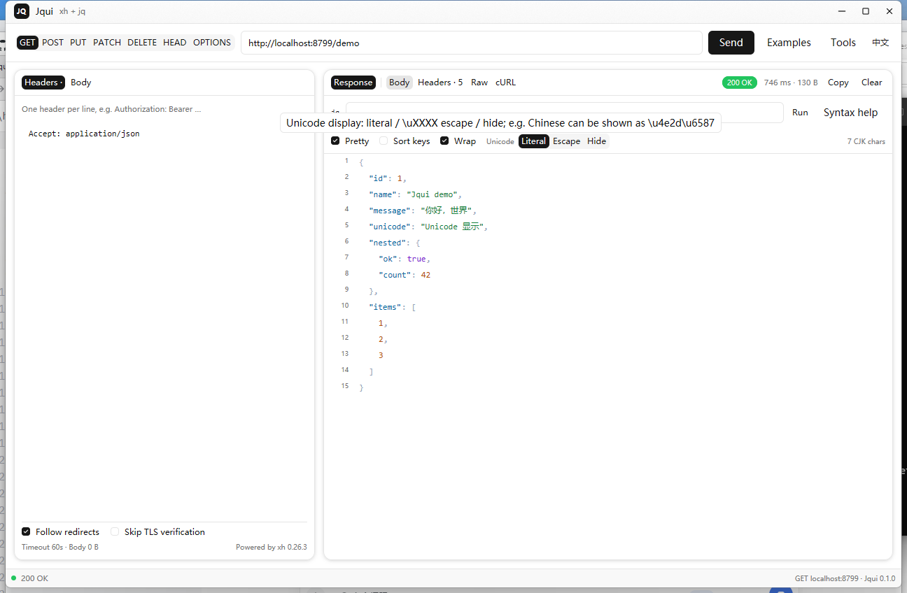

# Jqui

[](https://github.com/yorelog/jqui/actions/workflows/release.yml)
[](LICENSE)

[English](README.md) | **中文**

Jqui 是一个基于 [gpui-shell](https://gpui-kit.com/) 的桌面 HTTP / JSON 工具。它把 **xh** 的请求能力和 **jq** 的查询能力放进一个窗口，并专门处理中文等非 ASCII 内容的显示切换。



## 功能

- **任意 HTTP 请求**：GET / POST / PUT / PATCH / DELETE / HEAD / OPTIONS，自定义 URL、请求头和请求体。
- **真实 jq**：通过随包附带的原生 `jq` 执行完整 jq 语法——变量、`reduce`/`foreach`、自定义函数、正则和全部内置函数。
- **请求编辑**：请求头一行一个，JSON 请求体一键格式化，自动补 `Content-Type: application/json`，支持跟随重定向和跳过 TLS 校验。
- **响应视图**：顶层 **响应 / 原始 / cURL**；响应内再分 **响应体 / 响应头**，jq 工具栏只属于响应体。支持美化或紧凑 JSON、排序键、长行自动换行、逐行复制。原始视图也可以把完整响应美化成 JSON。
- **Unicode 显示**：中文等非 ASCII 内容的 `原文` / `\uXXXX` 转义 / `隐藏为 ·` 三种模式，并统计展示结果中的中文字数；Unicode 开关和各模式都有悬停说明。
- **双语界面**：右上角可切换中文 / English，选择会被记住。
- **工具更新**：检查 GitHub Releases 上的 xh / jq 新版本，按当前平台下载、安装到应用数据目录，失败时自动回滚。

## 安装

### 预编译包

从 [Releases](https://github.com/yorelog/jqui/releases/latest) 下载最新包：

| 平台 | 安装包 | 启动方式 |
| --- | --- | --- |
| Windows x64 | `jqui-0.1.0-windows-x86_64.zip` | 解压后打开 `Jqui.exe`；绿色版，自带 gpui-shell 0.8.0。 |
| macOS universal | `Jqui-0.1.0-macos-universal.zip` | 解压后把 `Jqui.app` 拖入“应用程序”。包未签名。 |
| Linux x64 | `jqui-0.1.0-linux.tar.gz` + `install.sh` | 运行 `sh install.sh`，或解压后直接启动。 |

macOS 包未签名、未公证。首次启动请右键应用并选择“打开”，或清除隔离标记：

```bash
xattr -dr com.apple.quarantine /Applications/Jqui.app
```

Linux 需要可用的 Vulkan 驱动、`libxkbcommon`、WebKitGTK 4.1 运行时（`libwebkit2gtk-4.1-0`），以及 Wayland 或 X11 会话（gpui-shell 的要求）。

Windows 包自带构建时的 gpui-shell 运行时；macOS / Linux 包会使用已安装的 gpui-shell，或在首次启动时下载固定版本的 0.8.0。

### 从源码运行

需要：

- [gpui-shell 0.8.0](https://gpui-kit.com/) 在 `PATH` 中
- Node.js 18 或更高版本（只用于下载工具）
- `tar`（Windows 10+、macOS 和大多数 Linux 自带）
- Linux 构建需要 `libwebkit2gtk-4.1-dev`、`libwayland-dev`、`libxkbcommon-x11-dev`、`libx11-xcb-dev`、`libssl-dev`、`libzstd-dev`、`libasound2-dev`、`libfontconfig-dev`、`libvulkan1`（发布工作流会自动安装）

```bash
git clone https://github.com/yorelog/jqui.git
cd jqui
node scripts/fetch-tools.mjs        # 下载当前平台的 xh / jq
gpui-shell check -d .
gpui-shell run -d .
```

开发时使用 `gpui-shell dev -d .`，保存文件后自动重载。工具版本固定为 xh 0.26.3 和 jq 1.8.2，并用 SHA-256 校验。二进制不进 Git；发布包会为每个平台内置正确的原生工具。

### 构建安装包

`gpui-shell bundle` 打包应用，但原生工具必须已经放在应用目录中。先为每个平台准备干净的 staging 目录：

```bash
mkdir -p staging
cp -R main.js gpui-shell.json lib icons staging/
node scripts/fetch-tools.mjs --platform linux --arch x64 --out staging
gpui-shell check -d staging
gpui-shell bundle -d staging --platform linux --out dist \
  --icon icons/app-icon.png \
  --download-url "https://github.com/yorelog/jqui/releases/latest/download"
```

把 `--platform` 换成 `windows`、`macos` 或 `linux`。macOS 上可以用 `--arch universal`（需要 `lipo`）生成同时支持 Apple silicon 和 Intel 的 xh/jq。

## 发布

发布由 [`.github/workflows/release.yml`](.github/workflows/release.yml) 完成：

```bash
git tag v0.1.0
git push origin v0.1.0
```

工作流会先检查 tag 是否与 `gpui-shell.json` 的 `version` 一致，然后构建：

- Windows x64 绿色 zip
- macOS universal `.app` zip（xh/jq 同时包含 arm64 与 x64）
- Linux x64 tar.gz 与 `install.sh`
- `SHA256SUMS.txt`

所有产物会自动附加到 GitHub Release。也可以在 **Actions → Release → Run workflow** 中手动输入 tag 运行。

工作流默认通过 gpui-kit 的 `install.sh`（macOS/Linux）或 Windows 最新 release 资产安装**最新** gpui-shell，并校验 SHA-256。需要可复现构建时，把 `gpui_shell_version` 输入设为具体 tag（如 `v0.8.0`）。Windows zip 会打包构建时的运行时；macOS/Linux 包不内嵌运行时。

发布包未签名、未公证：macOS 用户需要右键“打开”，Windows 可能显示 SmartScreen 提示。

## 使用

### 请求

1. 选择 method，填写 URL；缺少 scheme 时按 `https://` 处理。
2. 在 **请求头** 中一行写一个，例如 `Authorization: Bearer …`。
3. 在 **请求体** 中填写 body；JSON 会自动补 `Content-Type: application/json`。
4. 点击 **发送**。需要时打开 **跟随重定向** 或 **跳过 TLS 校验**。

### jq

jq 对整个响应 JSON 求值，可以产生零个、一个或多个结果：

```jq
.                                  # 整个文档
.user.name                         # 取字段
.items[]                           # 展开数组 / 对象
.items[0].id                       # 取下标
.a, .b                             # 多个结果
.a | .b                            # 管道
.a // "default"                    # 缺失时使用默认值
map(.id)                           # 映射
map(select(.ok))                   # 过滤
sort_by(.id)                       # 排序
group_by(.type)                    # 分组
{name, stars: .stargazers_count}   # 构造对象
[.items[].id]                      # 构造数组
reduce .[] as $x (0; . + $x)       # 聚合
.headers | to_entries[]            # 多个结果
```

多个结果会以数组展示，并在工具栏显示结果数量。找不到 jq 时会回退到内置子集，并在语法帮助中提示。

响应面板分为 **响应（响应体 / 响应头）**、**原始** 和 **cURL**。响应体拥有 jq 工具栏、美化/紧凑、排序键和自动换行；响应头只展示 headers，不显示 jq 控件；原始和 cURL 是独立的顶层视图。

响应工具栏的 **换行** 开关默认开启：长 JSON 行（包括很长的字符串和 title）会按窗口宽度自动换行；关闭后回到固定单行列表。选择会被记住。

**原始** 视图有自己的 **美化 JSON** 开关和 Unicode 显示切换。美化会格式化**完整响应**，不受 jq 筛选影响；复制时会复制当前视图显示的内容。

### Unicode 显示

响应工具栏的 **Unicode** 开关有三种模式：

- **原文**：按字符显示，例如 `"你好，世界"`。
- **转义**：所有非 ASCII 字符转成 JSON `\uXXXX`，代理对也会正确转义。
- **隐藏**：所有非 ASCII 字符替换为 `·`，保留 JSON 结构。

把鼠标悬停在 **Unicode** 标签或任意模式上，会显示它会做的转换，例如中文 `中文` → `\u4e2d\u6587`。该设置同时作用于“响应”视图、“原始”文本和复制内容；工具栏会显示当前展示结果的中文字数。



### 界面语言

右上角的 **EN / 中文** 按钮切换界面语言，选择会保存并在下次启动时恢复。界面和仓库 README 都提供中英文。

### 工具与更新

打开 **工具**：

- **检查更新**：读取 xh / jq 的最新稳定 GitHub Release，按当前平台和架构选择资产。
- **更新**：通过 xh 下载，用系统 `tar` 解压，安装到应用数据目录的 `tools/` 下；旧版本保留为 `.bak`，新版本启动失败时自动回滚。
- 更新后后续请求和 jq 查询立即使用新版本，无需重启。
- 不会修改应用目录；删除 `tools/` 即回到随应用附带的版本。
- GitHub API 未登录时每小时最多 60 次检查，超出会在面板显示限流提示。

## 平台支持

更新器根据运行平台和 CPU 架构选择资产：

| 平台 | xh 资产 | jq 资产 |
| --- | --- | --- |
| Windows x64 | `xh-…-x86_64-pc-windows-msvc.zip` | `jq-windows-amd64.exe` |
| Windows arm64 | x64 版本（仿真；xh 暂无原生 Windows arm64） | `jq-windows-arm64.exe` |
| macOS arm64 | `xh-…-aarch64-apple-darwin.tar.gz` | `jq-macos-arm64` |
| macOS x64 | `xh-…-x86_64-apple-darwin.tar.gz` | `jq-macos-amd64` |
| Linux arm64 | `xh-…-aarch64-unknown-linux-musl.tar.gz` | `jq-linux-arm64` |
| Linux x64 | `xh-…-x86_64-unknown-linux-musl.tar.gz` | `jq-linux-amd64` |

其他平台或 32 位架构会显示“没有适用于当前平台的发布包”，不会下载错误的二进制。Windows 用 `cmd.exe` 包装子进程并补齐 `SystemRoot` 和代理变量；macOS / Linux 用 `chmod +x`；压缩包统一用系统 `tar` 解压。

## 请求是怎么发出去的

gpui-shell 原生 `fetch` 的能力模型要求逐个声明精确的 host / method / path，无法支持“输入任意 URL”的 API 客户端。Jqui 因此使用 xh：

1. 请求头和请求体先写入应用数据目录中的临时文件；
2. xh 输出“响应头 + 空行 + 响应体”；
3. Jqui 解析状态行和响应头，再把响应体交给 jq；
4. 请求结束后删除临时文件。

Windows 上 gpui-shell 给子进程的是空环境，Winsock 没有 `SystemRoot` 会初始化失败。Jqui 会生成一个很小的 `.cmd` 包装脚本补齐变量；请求头值也通过文件传递，因此引号、`%`、`&`、`@` 不会被 `cmd.exe` 解释。

## 能力声明

`gpui-shell.json` 请求了：

```json
"fs": {
  "read": ["${pluginDir}", "${dataDir}"],
  "write": ["${dataDir}"],
  "execute": "*"
},
"network": {
  "http": [
    {
      "scheme": "https",
      "host": "api.github.com",
      "methods": ["GET"],
      "path_prefixes": [
        "/repos/ducaale/xh/releases/latest",
        "/repos/jqlang/jq/releases/latest"
      ]
    }
  ]
},
"storage": true,
"clipboard": { "write": true }
```

- `execute: "*"` 是无限制执行。应用目录里或更新后的 xh/jq 使用绝对路径执行，而 gpui-shell 的白名单只匹配精确命令名。要收紧权限，可以把 xh/jq 安装到 `PATH`，改成 `["xh", "xh.exe", "jq", "jq.exe"]`；Windows 仍需要 `cmd.exe` 做环境包装。
- 原生 `network.http` 只授予两个 GitHub release 检查端点；真正的 API 请求由 xh 发出，不受该授权限制。
- 读取根是应用目录和数据目录；写入只限数据目录。

## 限制

- 单次响应受 gpui-shell `process.run` 约 8 MiB 输出上限约束；特别大的响应请用 jq 缩小结果。
- 只记住上一次请求（URL、请求头、请求体、jq 表达式），还没有请求集合/历史列表。
- HEAD 响应按 HTTP 语义没有 body。
- Windows 上 URL 不能包含字面双引号，请编码为 `%22`。
- 内置 jq 子集只是回退；发布包包含真正的 jq。
- 安装包未签名，macOS / Windows 会出现各自的首次运行提示。

## 安全与隐私

- 上次请求（包括请求头里的 token）保存在 gpui-shell 应用数据目录：
  Windows 为 `%APPDATA%\gpui-shell\apps\local.jqui\store.json`。共享机器上请使用“清空”或删除该文件。
- 请求头/请求体/JSON 临时文件也在这个数据目录中，请求结束后删除。
- 应用不发送遥测，也不会把请求内容写到别处。
- 工具更新通过 HTTPS 从 GitHub Releases 下载；打包脚本用 `scripts/fetch-tools.mjs` 中固定的 SHA-256 校验，运行时更新校验下载大小。

## 代码结构

```text
main.js                 # 界面、状态、事件
lib/i18n.js             # 中英文界面文案
lib/http.js             # xh 调用、Windows cmd 包装、响应解析
lib/jq-runner.js        # jq 调用与多结果处理
lib/jq.js               # 内置 jq 子集（仅回退）
lib/tools.js            # xh/jq 版本检查、平台资产、安装与回滚
lib/json-view.js        # JSON 分行、着色、Unicode 转义/隐藏
lib/runtime.js          # 平台、架构、捆绑/已安装工具路径
lib/store.js            # 记住上次请求
scripts/fetch-tools.mjs # 为目标平台下载固定版本的 xh/jq
icons/                  # 窗口控制、复选框、加载、应用图标
.github/workflows/      # 多平台发布工作流
docs/                   # 界面截图
gpui-shell.json         # 应用清单
gpui-kit.d.ts           # gpui-shell 生成的类型声明（不要编辑）
```

## 第三方

- [xh](https://github.com/ducaale/xh) — MIT License
- [jq](https://github.com/jqlang/jq) — MIT License
- [gpui-kit](https://github.com/longbridge/gpui-kit) — Apache-2.0 / MIT

`xh` 与 `jq` 是各自项目的独立可执行文件；Jqui 只通过命令行调用它们。

## 许可证

[MIT](LICENSE)
